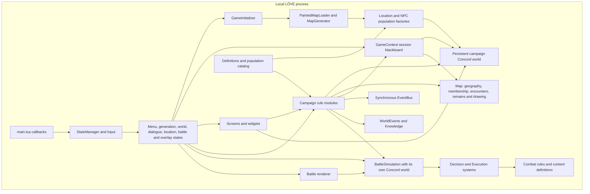
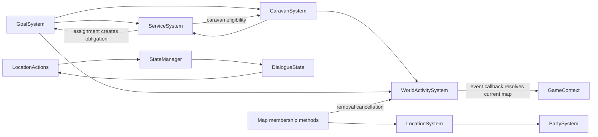
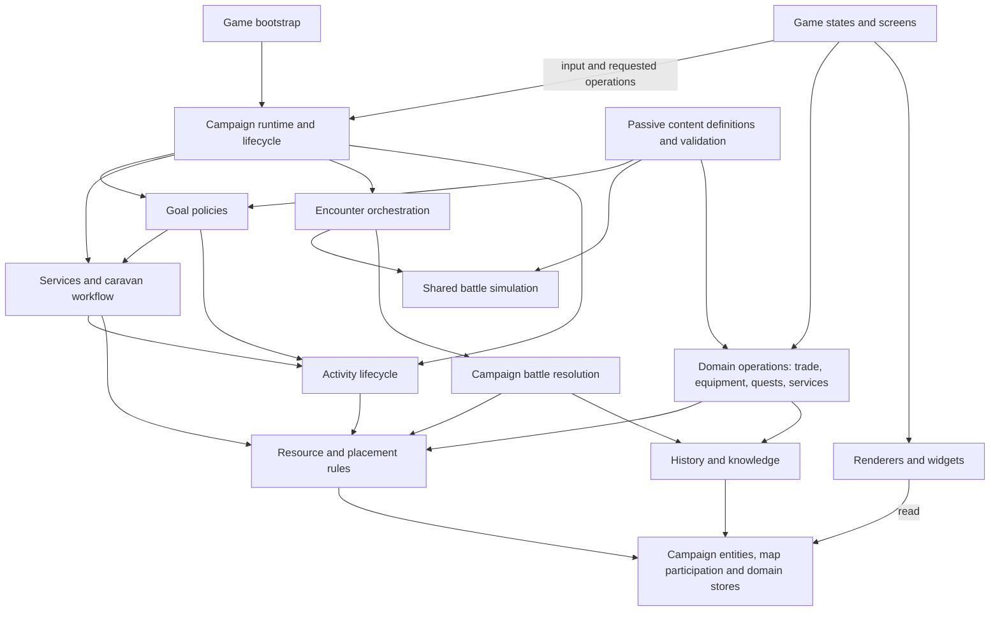

# Realm of Geherra: architectural assessment

Assessed 28 October 2026 at repository revision `e56c510`, with a clean working tree before this report was added. This is a structural assessment of the local LÖVE/Lua implementation, including its vendored Concord behavior. No game code was changed.

## Judgment

The game has a coherent **domain direction**, but only partially coherent **runtime boundaries**. Its best ideas are already implemented: durable campaign identity, separate transient battle worlds, actor-owned goals, party-owned activities, real resource transfers, and a distinction between objective history and an actor's knowledge. Preserve those ideas.

The main obstacle to extension is that coordination and authority remain distributed across presentation states, singleton modules, map membership collections, and newer workflow modules. Adding content within an established shape is often straightforward; adding a new kind of behavior still requires knowing several special paths. The next architectural work should unify those paths, not introduce a framework or replace ECS.

Recommended order: establish campaign lifecycle and ownership, converge battle consequences, remove the goals/services/caravans cycle, move resource operations out of screens, then reorganize files around those proven boundaries. Persistence needs an explicit snapshot contract before it is implemented. A broad directory reshuffle should come last.

## Scope and evidence rules

- **Observed** means supported by inspected implementation. Tables and diagrams describing the current system are observed unless marked otherwise.
- **Inferred** means an architectural consequence or recommendation drawn from that implementation. Concern sections explicitly separate observations from inferences and alternatives.
- **Reported** means a stated design intention, rather than verified behavior.
- **Unknown** means not established by this assessment.

The requested six areas are covered below. The previous DSA audit was reported by the requester; its artifact was not found among the repository documents inspected. Individual bugs, algorithms, local data-structure improvements, formatting, and performance prescriptions are deliberately excluded. Findings below concern responsibility and change propagation, even when the same files may have appeared in that audit.

This was source analysis, not a playtest. Existing scenario coverage was inspected as evidence of test seams, but scenarios were not executed. No claim about current test success, measured performance, complete save compatibility, or team ownership follows from this report. No external research was necessary to assess this repository's implementation.

## 1. Existing architecture

### Runtime and dependency map

Arrows mean calls or uses, not a claim that each box is a clean layer. Everything shown runs locally in one LÖVE process.



Evidence: [entry point](D:/Projects/Realm-of-Geherra/main.lua), [state registration and dispatch](D:/Projects/Realm-of-Geherra/src/core/state_manager.lua), [initialization](D:/Projects/Realm-of-Geherra/src/game/game_initializer.lua), [campaign world](D:/Projects/Realm-of-Geherra/src/ecs/world.lua), [world state](D:/Projects/Realm-of-Geherra/src/game/states/world_state.lua), [map](D:/Projects/Realm-of-Geherra/src/world/map.lua), [battle simulation](D:/Projects/Realm-of-Geherra/src/game/battle/battle_simulation.lua).

### Main feature flows

| Capability | Current path and boundary |
|---|---|
| New campaign | Generation state → initializer → painted generation → map conversion → location population → NPC/party factories → campaign entities and map placement. |
| Overworld | World state interprets input, decides whether time advances, moves the player, updates encounters/goals/recovery/AI/activities/visibility, and handles interaction and rendering. |
| NPC agency | Actor goal state → GoalSystem selection → existing party activity, local service behavior, or caravan workflow. Party activity owns physical movement while active. Legacy party AI/default raids remain for other parties. |
| NPC combat | Contact → WorldEncounterSystem reservation and runner → shared BattleSimulation → loot planning/application and campaign casualty application → history and knowledge → activity notification. |
| Player combat | World/dialogue transition → BattleState → same BattleSimulation → BattleState-specific casualty/reward/history processing → result screen or menu. |
| Location interaction | Location state/screen derives available actors and actions; registry dispatches location actions; dialogue state builds and filters conversations and dispatches gameplay actions. |
| Quests | Template/pool → NPC offer state → accepted quest entity → event/objective progress → report/completion → rewards. |
| Services and caravans | Local availability or learned offer → service assignment → actor obligation → caravan preparation/work → existing TravelActivity → financial delivery and service closure. |
| Player management | Inventory, equipment, shop, character, party, quest-log screens, plus supporting systems/widgets. Ownership of complete operations varies by screen. |
| Developer inspection | Debug fixture/tools and F1/F2/F3 views expose actor decisions, objective events, and service state. These global views are intentionally distinct from NPC knowledge. |

Supporting evidence: [population](D:/Projects/Realm-of-Geherra/src/systems/npc_population_system.lua), [NPC factory](D:/Projects/Realm-of-Geherra/src/systems/npc_factory.lua), [activities](D:/Projects/Realm-of-Geherra/src/systems/world_activity_system.lua), [NPC encounters](D:/Projects/Realm-of-Geherra/src/systems/world_encounter_system.lua), [player battles](D:/Projects/Realm-of-Geherra/src/game/states/battle_state.lua), [quests](D:/Projects/Realm-of-Geherra/src/systems/quest_system.lua), [services](D:/Projects/Realm-of-Geherra/src/systems/service_system.lua), [caravans](D:/Projects/Realm-of-Geherra/src/systems/caravan_system.lua), [scenario registration](D:/Projects/Realm-of-Geherra/tests/unit/main.lua).

### Important coupling relationships



Some reverse edges use function-local imports. That postpones module loading; it does not remove semantic coupling. Evidence: [service assignment/volunteering](D:/Projects/Realm-of-Geherra/src/systems/service_system.lua:247), [goal evaluation](D:/Projects/Realm-of-Geherra/src/systems/goal_system.lua:427), [activity callbacks](D:/Projects/Realm-of-Geherra/src/systems/world_activity_system.lua:126), [location actions](D:/Projects/Realm-of-Geherra/src/systems/location_actions.lua), [map membership](D:/Projects/Realm-of-Geherra/src/world/map.lua:237).

| Coupling lens | Assessment |
|---|---|
| Static | The import/call cycles above cross responsibilities. Battle execution and rendering are separated, but battle files are spread across three directory roots. |
| Dynamic | EventBus invokes listeners synchronously. An emitted contact or completion notification can enter other systems before the emitter returns. The NPC encounter module already acts as a named workflow coordinator. |
| Data | Entity fields and mutable rosters are broadly accessible. Service getters/history getters return copies, while map and party collection access returns live data. Neither policy is universally wrong, but they express different mutation contracts. |
| Temporal | Campaign update order, encounter reservations, goal ownership sequences, terminal cleanup, and pause rules matter. Those dependencies are currently visible most clearly in WorldState rather than in a campaign simulation entry point. |
| Deployment | This is a single local game. No evidence supports splitting it into independently deployed services or processes. Keep module boundaries in the same process. |
| Organizational/change history | Ownership and recurring co-change patterns are unknown. Commit titles and milestone documents do not establish a team topology or measured change cost. Recommendations are based on code dependencies, not claimed churn metrics. |

## 2. Data architecture and ownership

### Current authority map

| State | Authority and write path | References, projections and architectural status |
|---|---|---|
| Static content | Lua definition modules, explicit manifests, population types/catalog | Strong validation for population/location content; older item, troop, quest and dialogue definitions use different conventions. Definitions should remain read-only inputs. |
| Actor identity and condition | Campaign Concord entity; Unit assemblage/factories initialize it; gameplay modules update flat fields | The `unit` component is a marker. Identity, HP, equipment, inventory and affiliation live on the entity, not inside that component. Optional goals/memory/work components contain actual state. |
| Party composition and assets | Campaign party entity; PartySystem membership/resource helpers | Actor roster contains direct entity references; leader is an ID. Shared cargo and treasury belong to the party, personal belongings to the actor. This domain distinction is sound. |
| Location population | Campaign location entity; location/population systems | Independent residents and stationed parties are separate collections. Available NPCs are derived from them, preserving the same actors across travel and residence. |
| Spatial participation | Map traveling-party/location collections plus location stationed-party collections | Map membership is more than a rendering cache: it defines participation and placement. The ECS world owns entity lifetime, but map removal is not equivalent to entity destruction. |
| Player/session | GameContext player/party IDs, current map, flags, relations, difficulty, playtime and lazily added time/dialogue state | Player/party accessors resolve IDs. A separate legacy companion-ID list also exists in GameContext; it is a competing roster-shaped API, not evidence that every caller uses two rosters. |
| World clock | Day/hour in GameContext; TimeSystem owns conversion and advancement | Pause, time scale and fractional accumulator are module locals. Session reset therefore spans more than GameContext initialization. |
| Goal decisions | Actor `npc_goals` component | GoalSystem selects and tracks attempts/activity ownership. Service assignment also inserts/selects obligation goals; this contributes to the service/goal cycle. |
| Physical activities | Party `world_activity` component | ActivitySystem controls lifecycle, sequence, cancellation and executor selection; executor-specific state shares a broad common record. Legacy party movement fields coexist. |
| Service contracts | Campaign world's `serviceRequests` table | ServiceSystem owns current status and returns copies. Worker obligations/work reference service IDs rather than duplicating hiring status. |
| Caravan lifecycle | Sponsor `caravan_formation`, worker `caravan_work`, actual party resources | Preparation, assignment, physical trip and funding are distinct. Their separation is meaningful, although orchestration dependencies need tightening. |
| Quest lifecycle | Campaign quest entity, nested objective tables; NPC-owned offer state | Template ID, runtime instance ID and giver ID are distinct. Completed quests stay in the same entity population. Offer refresh is location-entry driven. |
| Objective history | WorldEvents module's weak-keyed per-world store | Immutable plain snapshots, stable event IDs, source-key deduplication; separate from mutable entities and transient EventBus notifications. Serialization export exists. |
| Actor/party knowledge | `memory` component keyed by event ID and learned detail flags | KnowledgeSystem projects only learned details. Runtime world provenance is held outside serialized component data. This boundary must survive restoration deliberately. |
| Encounters and remains | Map encounter/remains collections, managed by domain modules | Active runner objects are transient; remains contain durable plain resource/history data and have separate serialization helpers. |
| Battle state | Per-simulation world/context and battle-unit entities | Temporary position, HP, intents, cooldowns, equipment copies, casualties and effects. Context also contains camera, targeting and selection data. |
| Disk persistence | No complete authoritative save format | Save module is a stub. Isolated allocator/history/remains exports are building blocks, not a campaign save implementation. |

Evidence: [entity assembly](D:/Projects/Realm-of-Geherra/src/ecs/assemblages/unit.lua), [party assembly](D:/Projects/Realm-of-Geherra/src/ecs/assemblages/party.lua), [location membership](D:/Projects/Realm-of-Geherra/src/systems/location_system.lua), [session context](D:/Projects/Realm-of-Geherra/src/game/game_context.lua), [clock](D:/Projects/Realm-of-Geherra/src/systems/time_system.lua), [history](D:/Projects/Realm-of-Geherra/src/systems/world_events.lua), [memory provenance](D:/Projects/Realm-of-Geherra/src/ecs/components/memory.lua), [quest assembly](D:/Projects/Realm-of-Geherra/src/ecs/assemblages/quest.lua), [remains persistence](D:/Projects/Realm-of-Geherra/src/systems/battlefield_remains_system.lua), [save placeholder](D:/Projects/Realm-of-Geherra/src/core/save.lua).

### What the data model should preserve

**Observed:** An actor remains the same entity while becoming a resident, party member, leader or caravan worker. A party can be stationed without being disbanded. Cargo and personal possessions are distinct. The allocator is campaign scoped and preserves used IDs. Goal/activity/service records use stable references for long-lived links.

**Inferred:** This is the right foundation for emergent gameplay. Turning every nested table into an ECS entity would make it harder to follow. Keep objectives, service records, history entries and item stacks as plain data unless they independently need ECS participation. Keep direct entity references in live rosters if useful; use stable IDs at persistence, historical and long-lived workflow boundaries.

## 3. Prioritized architectural concerns

### A1 — Campaign lifecycle is owned partly by the active screen [high]

**Observed.** [WorldState](D:/Projects/Realm-of-Geherra/src/game/states/world_state.lua:288) combines input, time admission, player movement, simulation scheduling, interaction, developer modals and drawing. Its update order is time → player movement/random encounters → existing world encounters → goals → recovery → default activities → legacy party AI → activities → visibility. [GoalSystem.update](D:/Projects/Realm-of-Geherra/src/systems/goal_system.lua:427) itself schedules service cleanup and caravan advancement. [StateManager.init](D:/Projects/Realm-of-Geherra/src/core/state_manager.lua:9) registers game states and initializes gameplay subscribers. WorldState entry initializes other subscribers. [TimeSystem](D:/Projects/Realm-of-Geherra/src/systems/time_system.lua) holds additional session state outside GameContext.

**Inferred consequence.** Understanding one campaign tick or reset requires understanding a screen, the goal evaluator and singleton initialization. A future nonvisual simulation or another screen that advances time would need to reproduce this ordering. Merely adding a service can unintentionally make its lifecycle depend on whether goals are being updated.

**Simpler alternative.** Add one ordinary campaign runtime module under `game/campaign/` that owns begin/reset/subscription setup and the ordered simulation step. Initially move the existing sequence intact; preserve paused behavior and the activity cleanup currently called with zero elapsed time. WorldState decides player input and whether time may advance, then invokes that module. GoalSystem evaluates goals only. Keep the clock conversion and explicit elapsed-unit names; there is no need to force every subsystem to use the same unit internally. Generic state-stack code should not initialize quests or encounters.

### A2 — Battle simulation is shared; campaign resolution is not [high]

**Observed.** [BattleSimulation](D:/Projects/Realm-of-Geherra/src/game/battle/battle_simulation.lua) is reused by both modes. [WorldEncounterSystem](D:/Projects/Realm-of-Geherra/src/systems/world_encounter_system.lua) prepares loot, validates/applies a campaign result, records history, teaches participants and releases reservations. [BattleState.checkBattleEnd](D:/Projects/Realm-of-Geherra/src/game/states/battle_state.lua:277) independently writes player actor state, removes casualties, generates drops/gold, removes the enemy party, awards favor and builds a history event.

**Inferred consequence.** A new combat consequence has two integration points even though combat itself is shared. History and persistent mutation can drift by participation mode. Player reward policy and universal casualty/resource consequences are entangled in the screen.

**Simpler alternative.** Extract result construction from the headless runner into the shared battle boundary, and let both modes submit the same terminal result to one campaign resolution operation. Reuse the existing result applier and loot planning/application rather than merge them into combat execution. Make player drop/favor policy explicit at that operation's caller; do not silently replace player rewards with NPC plunder rules. History/participant knowledge should be constructed once. BattleState should own commands, pacing and result presentation.

### A3 — Goals, service contracts and caravan execution form a dependency cycle [high]

**Observed.** [GoalSystem](D:/Projects/Realm-of-Geherra/src/systems/goal_system.lua) imports services and caravans, handles service discovery, delegates caravan sponsorship/work, and updates both modules. [ServiceSystem](D:/Projects/Realm-of-Geherra/src/systems/service_system.lua:247) calls GoalSystem to create obligations, calls CaravanSystem to validate caravan leaders, and contains player caravan volunteering and dispatch metadata rules. [CaravanSystem](D:/Projects/Realm-of-Geherra/src/systems/caravan_system.lua) calls services, activities, inventory, recovery and navigation.

**Inferred consequence.** The nominally general service registry knows one profession's execution and player control rules. Another profession would be tempted to add another branch to services and goals. Function-local imports make this cycle loadable but do not make ownership clear.

**Simpler alternative.** Keep ServiceSystem authoritative for request lifecycle and common eligibility. Move caravan eligibility/volunteer dispatch into the caravan workflow and have it call those common operations. Use one small obligation helper, based on GoalDefinitions, for assignment/closure updates so service records can stay synchronized with obligation state without depending on the full evaluator. Schedule services/caravans from the campaign runtime. Put each goal's feasibility and execution policy in a small explicit handler table or a few goal modules only as extracted behavior warrants. Keep recovery preemption centralized. No planner, general job framework, dependency injection container or arbitrary callback language is needed.

### A4 — Identity is centralized, but placement and membership authority are distributed [high]

**Observed.** [EcsWorld](D:/Projects/Realm-of-Geherra/src/ecs/world.lua) owns entity lookup/lifetime. [PartySystem](D:/Projects/Realm-of-Geherra/src/systems/party_system.lua:8) edits rosters. [LocationSystem](D:/Projects/Realm-of-Geherra/src/systems/location_system.lua) edits resident/stationed collections and derives available NPCs; its getter also cleans removed references. [Map](D:/Projects/Realm-of-Geherra/src/world/map.lua:237) validates traveling membership, unstations parties, stations with rollback, and cancels some activities on removal. Caravan dispatch composes resident/party transitions. [GameContext](D:/Projects/Realm-of-Geherra/src/game/game_context.lua:67) additionally exposes its own companion-list operations.

**Inferred consequence.** The roster, placement collections and entity lifetime are different concepts but their APIs do not make the difference immediately obvious. New relocation or disbanding code has to discover which combination of calls preserves exclusivity. A query that performs cleanup obscures the write path.

**Simpler alternative.** Retain campaign ECS identity and live roster references. Make the existing placement operations one discoverable authority for embark, station, resident transfer and removal, with invariants documented beside them. Move Map's lifecycle side effects there; Map remains geography and participation data. First remove or delegate the legacy GameContext roster API after checking its callers. Separate cleanup from read-only availability queries when the lifecycle module can guarantee cleanup. Do not add a second membership index merely to normalize the model.

### A5 — ECS state has two schema conventions, with no complete persistence boundary [high before save/load]

**Observed.** [Unit/party/location markers](D:/Projects/Realm-of-Geherra/src/ecs/components/unit.lua) identify entities whose durable fields are assigned directly by assemblages. [Goal state](D:/Projects/Realm-of-Geherra/src/ecs/components/npc_goals.lua) and [activity state](D:/Projects/Realm-of-Geherra/src/ecs/components/world_activity.lua) instead live inside real data components. Vendored [Entity.serialize](D:/Projects/Realm-of-Geherra/src/libs/concord/entity.lua:242) serializes registered components rather than all flat entity fields. History is held outside the world object; service requests are attached to it; allocator and remains have separate exports. [Save](D:/Projects/Realm-of-Geherra/src/core/save.lua) has no implemented save/load workflow.

**Inferred consequence.** Runtime persistence across screens is being conflated with disk serializability. Serializing the Concord world is not, by itself, a campaign snapshot. Moving all fields into components would touch nearly every reader and writer without being necessary for the current game.

**Simpler alternative.** Explicitly adopt the current hybrid ECS convention: markers define entity kinds; assemblages define core record schemas; optional data components own independent capabilities/workflows. Define a versioned campaign snapshot boundary that explicitly includes flat durable fields, optional components, clock/session state, membership IDs, services, history/deduplication data, allocator state and remains. Restore identities first, then links and memory provenance. Rebuild graphics, caches, active runners and subscriber state. Decide explicitly whether saving during a battle is supported; that feature is currently unknown. Write one round-trip scenario when persistence is undertaken. No save framework is needed now.

### A6 — Complete resource operations are split between screens and rule modules [medium-high]

**Observed.** [InventoryScreen](D:/Projects/Realm-of-Geherra/src/ui/screens/inventory_screen.lua:353) invokes equipment rules and directly consumes inventory stacks/returns displaced equipment, with another drag/drop path. [ShopScreen](D:/Projects/Realm-of-Geherra/src/ui/screens/shop_screen.lua:80) checks trading eligibility, determines price and sequences item/gold changes. [InventorySystem](D:/Projects/Realm-of-Geherra/src/systems/inventory_system.lua) already owns transfers, while services and loot use explicit domain operations.

**Inferred consequence.** The same operation cannot be reused by NPCs, scripts or another input path without reproducing screen behavior. Tests of transfers alone cannot establish the behavior of the whole purchase/equip action. This contradicts the reported rule that UI does not mutate game state directly.

**Simpler alternative.** Move the complete buy/sell operation into the existing trader module and inventory-to-equipment operation into equipment rules, passing the actual owners. Screens submit intent and display returned outcomes. Keep mouse/keyboard/drag selection in UI. Do not add a universal command bus or replace all direct field reads with getters.

### A7 — Items and inventories use competing representations [medium]

**Observed.** [Unit assembly](D:/Projects/Realm-of-Geherra/src/ecs/assemblages/unit.lua) starts with a count-map inventory; [party assembly](D:/Projects/Realm-of-Geherra/src/ecs/assemblages/party.lua) starts with a stack list. Trader hydration also uses lists. [InventorySystem](D:/Projects/Realm-of-Geherra/src/systems/inventory_system.lua) supports both and handles metadata-compatible stacks. [Item](D:/Projects/Realm-of-Geherra/src/entities/item.lua) inherits an older behavior-bearing Entity, and [loot generation](D:/Projects/Realm-of-Geherra/src/systems/loot_generator_system.lua) constructs those items; newer transfer/history/resource paths favor plain data. Equipment stores item definition IDs with durability kept separately.

**Inferred consequence.** A caller's item/owner shape changes what metadata can be represented and which methods may be expected. The older Entity name also suggests a second general entity model when its active role is largely item construction.

**Simpler alternative.** Favor the existing metadata-capable stack list as the eventual inventory representation for actors, parties and traders, using InventorySystem as the mutation boundary. Migrate one owner type at a time and retain a temporary adapter only while needed. Replace old Item method dependence with plain record construction and shared stack functions. Keep equipment ID slots and their established durability behavior until actual instance-specific equipment requirements justify a richer model. Do not create ECS entities for ordinary stacks.

### A8 — Content extension conventions vary by subsystem [medium]

**Observed.** [Population catalog](D:/Projects/Realm-of-Geherra/src/data/population/catalog.lua) validates typed definitions and cross-references through explicit manifests. [GoalDefinitions](D:/Projects/Realm-of-Geherra/src/systems/goal_definitions.lua) combines runtime creation/validation, capability vocabulary, form metadata and debug form conversion, while GoalSystem still branches on goal types. [Location action registry](D:/Projects/Realm-of-Geherra/src/systems/location_action_registry.lua) has an explicit dispatch table, but most handlers remain in one [location-actions module](D:/Projects/Realm-of-Geherra/src/systems/location_actions.lua); wizard-tower examination is a dedicated handler. Skills/statuses/quests/dialogues use other tables and interpreters.

**Inferred consequence.** Registering a definition does not consistently mean the behavior is extensible: a goal needs evaluator changes, a location action may require editing a general module, and validation under `data/` imports behavior registries under `systems/`. Authoring knowledge is spread across construction, runtime branching and editor conversion.

**Simpler alternative.** Keep explicit manifests and ordinary Lua tables. State a small per-domain extension contract: definition, validation, executor and optional presentation metadata. Extract goal form conversion into debug UI while keeping shared validation authoritative. Move cross-domain catalog assembly/validation to initialization if needed to keep definition imports passive. Extract location handlers when they have substantial independent behavior, not one file per trivial action. Do not force skills, quests and locations through one generic registry.

### A9 — Legacy and emergent gameplay coexist without a sufficiently explicit boundary [medium]

**Observed.** [QuestAvailabilitySystem](D:/Projects/Realm-of-Geherra/src/systems/quest_availability_system.lua) refreshes NPC offers on location entry; [QuestSystem](D:/Projects/Realm-of-Geherra/src/systems/quest_system.lua:267) can spawn targets at acceptance. Services/caravans instead derive behavior from existing actors, knowledge and resources. [PartyAiSystem](D:/Projects/Realm-of-Geherra/src/systems/party_ai_system.lua), default activities, and GoalSystem coexist. [WORLD_SIMULATION_DESIGN](D:/Projects/Realm-of-Geherra/docs/WORLD_SIMULATION_DESIGN.md) explicitly describes existing quest behavior and future causal opportunities as different stages.

**Inferred consequence.** This is a transitional architecture, not proof that the older path is wrong. It becomes drift when a new feature adds a third discovery/movement/offer path because the distinction is unclear.

**Simpler alternative.** Name legacy authored/spawned encounters and quests as supported content policies. Continue goal-driven activity ownership for new autonomous behavior. Introduce a goal/fact-derived quest-offer adapter only when an actual quest needs it, feeding the existing instance/objective/reward lifecycle. Keep contracts for NPC employment distinct from player narrative quests; share IDs and target references where appropriate, not a universal task entity. Retire legacy movement policy only as replacement coverage reaches those parties.

### A10 — Affiliation and reputation terminology lack one semantic contract [medium]

**Observed.** [NpcFactory](D:/Projects/Realm-of-Geherra/src/systems/npc_factory.lua) sets a singular faction and marks membership in an actor faction map. [FactionSystem](D:/Projects/Realm-of-Geherra/src/systems/faction_system.lua) uses the actor faction map as numeric reputation. [ReputationSystem](D:/Projects/Realm-of-Geherra/src/systems/reputation_system.lua) manages a separate reputation map, and [quest rewards](D:/Projects/Realm-of-Geherra/src/systems/quest_system.lua:399) apply faction-keyed reputation to the player party. [RelationshipSystem](D:/Projects/Realm-of-Geherra/src/systems/relationship_system.lua) stores player-to-NPC relations in GameContext. Faction definition modules exist both [globally](D:/Projects/Realm-of-Geherra/src/data/factions.lua) and [under population](D:/Projects/Realm-of-Geherra/src/data/population/factions/index.lua).

**Inferred consequence.** A future faction goal or diplomatic condition cannot infer ownership and meaning from the field/API names. Membership, standing and personal relation are distinct concepts, but those distinctions are not consistently expressed.

**Simpler alternative.** Define affiliation, faction standing and personal relationship separately, including whether standing belongs to actor or party. Rename/consolidate existing helpers around those decisions and have population faction configuration reference the authoritative faction vocabulary. Keep player-only relationship storage until NPC-to-NPC relationships are actually required. This is a semantic alignment task, not a demand for a social simulation framework.

### A11 — Geography, generation tooling and presentation are too interwoven [medium-low]

**Observed.** [Map](D:/Projects/Realm-of-Geherra/src/world/map.lua) combines navigation/geography queries, membership transitions, encounter/remains storage, images/caches and drawing. [PaintedMapLoader](D:/Projects/Realm-of-Geherra/src/systems/painted_map_loader.lua) converts the active painted generator output to a playable map. [MapGenerator](D:/Projects/Realm-of-Geherra/src/systems/map_generator.lua) includes generation, rendering/output stages and tooling behavior. A separate [WorldGenerationSystem](D:/Projects/Realm-of-Geherra/src/systems/world_generation_system.lua) remains, while [WorldMapState](D:/Projects/Realm-of-Geherra/src/game/states/world_map_state.lua:128) supports the live map and a standalone generated preview.

**Inferred consequence.** Similar names conceal different production/preview roles. Reusing geography in a nonvisual scenario requires awareness of LÖVE image state and membership side effects. Two generators do not automatically justify a shared abstract generator interface.

**Simpler alternative.** Identify painted generation as the active campaign pipeline, label retained alternatives/preview tooling explicitly, and remove unused alternatives only after checking all entry points and tests. Extract map drawing/image cache into a map renderer when editing that area; leave the useful geography methods together. Preserve the existing generation stepper and seed-based workflows. Do not split the large generator into arbitrary size-based files.

## 4. What is architecturally sound and should remain

| Keep | Why it is sound and evidence |
|---|---|
| Campaign versus transient battle worlds | Strong lifetime separation with a reusable nonvisual simulation. [Simulation](D:/Projects/Realm-of-Geherra/src/game/battle/battle_simulation.lua), [runner](D:/Projects/Realm-of-Geherra/src/systems/headless_battle_runner.lua). Finish consequence convergence; retain this boundary. |
| Plain systems operating on entity data | Fits Lua and Concord. Most rules are ordinary functions, with actual pooled Concord systems where battle iteration benefits. No need for character subclasses or behavioral ECS entities everywhere. [Assemblages](D:/Projects/Realm-of-Geherra/src/ecs/assemblages/unit.lua), [execution](D:/Projects/Realm-of-Geherra/src/ecs/systems/execution_system.lua). |
| Stable campaign identity | Allocator and typed lookups distinguish identity from names and historical snapshots. [Allocator](D:/Projects/Realm-of-Geherra/src/core/id_allocator.lua), [lookup](D:/Projects/Realm-of-Geherra/src/ecs/world.lua). |
| Goals versus activities versus obligations | Motivation, physical movement and accepted responsibility have different lifecycles. Actor/party/service ownership reflects that. [Goals](D:/Projects/Realm-of-Geherra/src/ecs/components/npc_goals.lua), [activities](D:/Projects/Realm-of-Geherra/src/ecs/components/world_activity.lua), [services](D:/Projects/Realm-of-Geherra/src/systems/service_system.lua). Improve dependencies, not the domain distinction. |
| History versus notification versus knowledge | EventBus is transient dispatch; WorldEvents retains objective facts; Knowledge exposes learned details. This supports investigation without omniscient NPCs. [History](D:/Projects/Realm-of-Geherra/src/systems/world_events.lua), [knowledge](D:/Projects/Realm-of-Geherra/src/systems/knowledge_system.lua). Do not turn history into a replay engine or expose debugger views to AI. |
| Loot resolution separated from application | An outcome can be reasoned about and validated before resource consequences are applied. [Resolver](D:/Projects/Realm-of-Geherra/src/systems/loot_resolver.lua), [application](D:/Projects/Realm-of-Geherra/src/systems/loot_application.lua). Keep validation and resource ownership intact. |
| Population as composition | Location definition, population profile, culture, archetype, faction and party composition vary independently. [Catalog](D:/Projects/Realm-of-Geherra/src/data/population/catalog.lua), [authoring guide](D:/Projects/Realm-of-Geherra/docs/POPULATION_AUTHORING.md). The two location directories represent different data, not needless duplication. |
| Real actor/party continuity | Stationing and caravan recruitment reuse the same actors, resources and parties. This supports meaningful consequences without cloning domain identities. [Locations](D:/Projects/Realm-of-Geherra/src/systems/location_system.lua), [caravans](D:/Projects/Realm-of-Geherra/src/systems/caravan_system.lua). |
| Combat rules versus execution versus visualization | Definitions describe skills/statuses, execution applies mechanics, renderer draws effects. Context can carry transient presentation payloads without creating a full event framework. [Combat rules](D:/Projects/Realm-of-Geherra/src/systems/combat_system.lua), [renderer](D:/Projects/Realm-of-Geherra/src/systems/battle/render_system.lua). |
| Scenario tests and developer inspection | Existing scenarios cross identity, time, activity, combat and knowledge boundaries. Inspectable goal reasons and event/service viewers make causal chains understandable. [Runner](D:/Projects/Realm-of-Geherra/tests/unit/main.lua), [debug fixture](D:/Projects/Realm-of-Geherra/src/debug/campaign_fixture.lua). Preserve these as migration seams. |

## 5. Project and module organization

The current top-level categories are understandable: `core`, `game`, `ecs`, `systems`, `world`, `ui`, `data`, `debug`, `utils` and vendored `libs`. Keep that overall vocabulary. The problem is that `systems/` now means almost all game behavior, while battle behavior is scattered among `game/battle`, `ecs/systems` and `systems/battle`. Conversely, the tiny `entities/` base model and `world/world.lua` suggest broader active abstractions than current inspected callers establish.

**Observed examples:** [core/game](D:/Projects/Realm-of-Geherra/src/core/game.lua) is a lifecycle placeholder; actual orchestration is elsewhere. [World container](D:/Projects/Realm-of-Geherra/src/world/world.lua) and [SceneLoader](D:/Projects/Realm-of-Geherra/src/world/scene_loader.lua) are not on the inspected active initialization path. Static source-reference searches found no active imports for those two modules; dynamic/future use is not established. Keep/remove decisions must follow caller checks, not their small size.

**Inferred recommendation:** Organize behavior by domain within `systems/`, retain ECS component/assemblage directories, and give campaign orchestration a home under `game/`. `world/` should describe geography/map data, not be a second campaign container. Keep content grouped by authoring role; do not move population profiles into location definitions merely because filenames match.

Illustrative destination below uses indentation rather than box drawing. It is a navigation proposal, not a request to create every folder or move every file now. Names without current counterparts describe the few extra seams recommended above.

```text
main.lua
conf.lua
src/
  core/                         input, events, schema, IDs, random, state-stack primitives
  game/
    bootstrap.lua               game-state and subscriber registration
    game_initializer.lua
    game_context.lua            session roots and player handles
    campaign/
      runtime.lua               lifecycle and ordered campaign step
      battle_resolution.lua     common campaign consequences
      snapshot.lua              only when persistence is implemented
    battle/
      battle_simulation.lua
      battle_context.lua
      battle_result.lua         result construction shared by both battle modes
    states/                     input and presentation coordination
  ecs/
    world.lua
    components/
    assemblages/
  systems/
    actors/                     attributes, skills, progression, player resources, recovery
    parties/                    roster rules and legacy party policy
    locations/                  population, placement, location rules and actions
      actions/                  substantial location-specific handlers
    goals/                      selection, definitions, obligation helper, bounded policies
    activities/                 lifecycle plus travel, raid, roam, rest, pursuit
    services/                   service lifecycle and caravan workflow
    encounters/                 encounter spawning, reservations and runner coordination
    combat/                     Concord decision/execution, combat rules, range helpers
    resources/                  inventory, equipment, traders, loot, remains
    quests/                     instances, objectives, offers
    social/                     relationships, faction standing, dialogue rules
    knowledge/                  objective history, projections, travel/battle knowledge
  world/
    map.lua                     geography and participation data
    camera.lua
    generation/                 painted generator, map conversion and retained tooling
  ui/
    screens/
    widgets/
    renderers/                  map and battle visualization
    knowledge_text.lua
    world_event_text.lua
  data/                         retain definitions, types, explicit manifests and profiles
  debug/                        tools, fixtures and goal-form conversion
  utils/                        only genuinely domain-neutral helpers
  libs/                         vendored Concord
tests/
  unit/                         existing scenario runner; reorganize only if discovery suffers
docs/                           current contract, authoring guides, historical milestone reports
```

Do not add forwarding modules for every move. Make each domain move in a dedicated mechanical change with all require paths, registration, scenario fixtures and documentation updated together. Leave unrelated asset/audio/packaging paths alone; their placement is not the main maintainability constraint established here.

## 6. Target dependency and state model



This is an **inferred target**, not the current import graph. The runtime provides explicit world/map/player handles to the boundary operations it coordinates. It is not a service locator and should not become the owner of every mechanic. Small pure helpers can keep their current direct inputs.

Authority rules:

1. Campaign entities own live actor/party/location/quest identity and durable domain fields. Core assemblages document those fields; optional components own independent state.
2. One placement boundary maintains travel/station/residence exclusivity. Ordered live collections may still contain entity references.
3. Resource operations own complete transfers; screens do not complete half an operation.
4. Goals choose why/what to attempt; activities own physical execution; service contracts own assignment status; caravan workflow owns its profession-specific phases.
5. Battle simulation owns temporary combat state; campaign resolution applies a terminal result. Player-specific rewards remain explicit policy.
6. History records facts after successful domain transitions; knowledge controls who learns which details. EventBus notifications do not replace return values for required commits.
7. GameContext is an explicit session root, not another actor roster. Transient graphics, runner objects, subscriptions and caches are excluded from durable snapshots.

Do not split every battle-context field now. Selection/camera data may remain in an optional presentation section until it obstructs headless reuse. The shared simulation already works without drawing; preserve that practical boundary rather than pursue abstract purity.

## 7. Extensibility assessment

| Addition | Current effort and friction | Coherent extension path |
|---|---|---|
| New NPC goal | Definition/capability registration plus several GoalSystem branches and possibly service/activity changes. Debug forms share the definition registry. | One validated goal definition and bounded policy handler using existing activity/service operations. Keep priorities and recovery ownership in the evaluator. |
| New world activity | Existing explicit executor table/lifecycle is a useful seam. Broad shared state/reset fields and default AI interaction require care. | One executor registered at the existing lifecycle boundary; common ownership/status stay central. Introduce type-local payloads only when shared fields become hard to reason about. |
| New service/profession | Generic requests exist, but healing, caravans, player volunteering and obligation creation overlap. | Reuse contract lifecycle and obligation helper; add profession workflow outside the service registry. Keep remote discovery knowledge-gated. |
| New location | Already strong for definitions, placement, rules, profiles and cultures; unique actions need handler registration. | Continue current typed authoring. Use a domain handler that returns an outcome; let state code choose the presentation transition. |
| New quest | Templates, giver identity, instances and objectives are established. Opportunities still largely use older availability/spawn policy. | Reuse existing instances/objectives/rewards. Add fact/goal-derived offers as another producer when needed, without duplicating quest state. |
| New combat mechanic | Shared battle simulation is a strong seam; execution/renderer changes may be necessary and are legitimate. Persistent effects currently need two completion paths. | Define mechanic data, implement resolution in execution/rules, visualize separately, and apply persistent consequences through the common result boundary. Do not build a general effect interpreter for hypothetical mechanics. |

## 8. Incremental migration plan

Each step is independently reviewable. The acceptance criteria are proposed future checks, not claims that this assessment ran them.

| Order | Change and scope | Completion evidence and guardrails |
|---|---|---|
| 0 — Document authority | Reconcile the current contract in PROJECT_DEFINITION and CAMPAIGN_ARCHITECTURE: hybrid ECS schema, placement versus lifetime, clock units, reset/subscription lifecycle, player/NPC resolution difference, legacy versus emergent paths. | A developer can trace one campaign tick and locate each authoritative write path. Mark milestone reports historical and the world-simulation document aspirational. No implementation change required. |
| 1 — Extract campaign runtime | Move existing ordered update/reset/subscription coordination from WorldState/StateManager/GoalSystem into the game-layer runtime. Keep input/pause admission and rendering in WorldState. | Existing time-sync, world-activity, NPC-goal, recovery, world-encounter, debug-pause and caravan scenarios; one lifecycle check proves reset and subscribe happen once per campaign. Preserve zero-time cleanup and current ordering first. |
| 2 — Unify battle consequences | Share terminal-result construction and campaign resolution; route both player and NPC modes through it. Keep player reward policy explicit. | Battle-simulation, headless-result, campaign-result, loot, remains and battle-knowledge scenarios, plus a small player/NPC equivalent-result integration case. Verify HP, membership, resources, history and notifications once. Do not change combat balance during extraction. |
| 3 — Break workflow cycles | Move caravan-specific assignment/volunteer rules to its workflow; isolate obligation updates; remove service/caravan scheduling from goal evaluation. Extract bounded goal policies as necessary. | Services/caravan/NPC-goal/recovery scenarios preserve assignment, interruption, funding, delivery and learned-offer behavior. Service lifecycle no longer imports caravan execution or the full evaluator. |
| 4 — Consolidate placement writes | Route embark/station/resident transfers through one placement authority. Delegate/remove obsolete GameContext roster operations after a caller inventory. Separate cleanup from queries where feasible. | Population, retinue, inline-party, travel and caravan scenarios preserve actor IDs and exclusive membership through departure/arrival/removal. No new duplicate state index. |
| 5 — Finish resource boundaries | Move whole trade/equipment operations from screens into existing domain modules. Then migrate inventory representations and old Item construction separately if still useful. | Cover purchase/sale and equip/unequip through the same operations used by UI. Preserve metadata, quantities, treasury ownership and durability. Keep screen interactions unchanged. |
| 6 — Align authoring and social semantics | Separate debug form conversion from goal semantics; document domain extension contracts; establish affiliation/standing/relationship meanings and owners. | Population/location validation plus one existing and one new definition demonstrate authoring without unrelated edits. Current quest reward and relation behavior is explicitly preserved or consciously changed. |
| 7 — Move files mechanically | Group each stabilized domain, move renderer/generation files, remove proven-unused scaffolding and update documentation. | Require-path and scenario registration checks resolve; run the existing suite for cross-domain moves. No behavioral refactor in the same commit. Keep this optional if improved navigation alone does not justify the churn. |
| Before save/load — Snapshot contract | Specify explicit durable fields and restoration order; implement only when requested. Can start after step 0 without waiting for directory moves. | Round-trip actors, rosters, services, goals/work, clock, history, memory and used IDs; rebuild presentation/transient state. Define handling of active encounters before promising saves there. |

Highest value first slice: **steps 0–2**. They make campaign flow and battle consequences legible without changing the game's domain model. Stop after each step if the next one lacks an immediate extension or comprehension benefit.

## 9. Limits, risks and assessment QA

**Observed constraints:** The game and vendored ECS run locally. Source searches surfaced filesystem use in generation/serialization helpers; no network client integration was identified in inspected game modules. This is not an exhaustive privacy/security audit. LÖVE and Concord are runtime/library dependencies, not remote services; no provider replacement is warranted.

**Reported versus implemented:** PROJECT_DEFINITION reports downward dependencies and no direct UI mutation as design rules; current files show exceptions. WORLD_SIMULATION_DESIGN describes future investigation/economy/quest directions and explicitly defers full saves. Neither document is evidence those features are already implemented.

**Migration risk:** The greatest risk is changing ordering, reward policy or membership semantics while trying to improve structure. Preserve those behaviors first and make any gameplay change a separate decision. Directory moves have a smaller conceptual benefit and broad require-path churn, so defer them.

Assessment QA: all 103 source-file links resolved, and all cited line numbers were within their target files. The three Mermaid blocks and illustrative directory listing have balanced fences; no box-drawing diagrams or copied implementation snippets are included. Cross-checking connects each concern to a target boundary and migration step. Diagram visual rendering and live game behavior were not verified here.

This assessment ends at architecture and migration planning. It does not execute the migration, repeat the DSA/bug audit, introduce new gameplay systems, or claim an implementation review of every branch.
