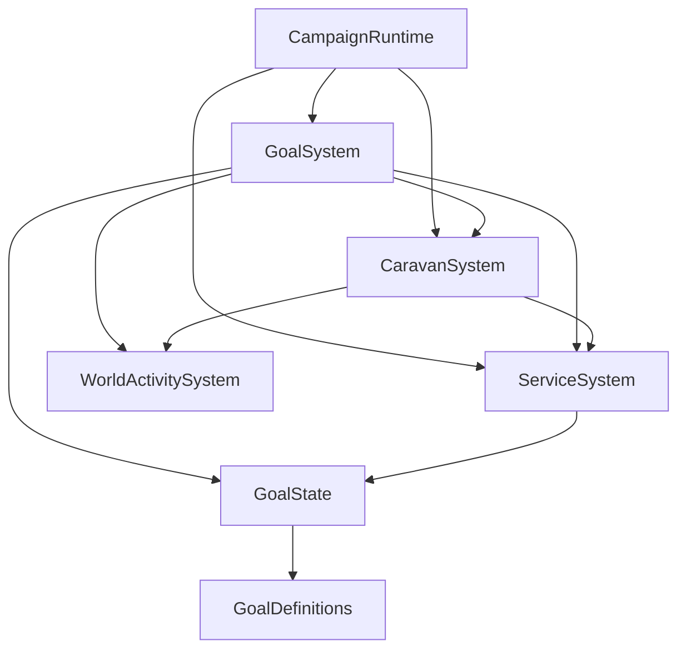

# A3 — Goals, services and caravans

The architecture assessment's A3 finding is addressed without changing directory
layout, goal definitions, activities, recovery policy, or caravan balance.

## Previous dependencies and runtime flow

A1 already established `CampaignRuntime.updateGoals`: flush the world, update
services, update caravan preparation/player work, then evaluate NPC goals.
`GoalSystem.update` was already an evaluation-only entry point after A1.

The remaining cycles were:

- `GoalSystem -> ServiceSystem -> GoalSystem`: assignment imported the evaluator
  to append an obligation, then selected that goal directly inside ServiceSystem.
- `ServiceSystem -> CaravanSystem -> ServiceSystem`: generic assignment imported
  caravan leader eligibility. The resulting three-module cycle also included
  `GoalSystem -> CaravanSystem -> ServiceSystem -> GoalSystem`.

NPC obligation evaluation called `CaravanSystem.fulfill`, whereas player work
advanced inside `CaravanSystem.update`. Thus physical workflow progression still
implicitly depended on running the evaluator for NPCs. ServiceSystem also knew
about player caravan replacement, caravan party dispatch markers, and caravan
exceptions to participant cleanup and notification.

## Dependency direction and authority

`GoalState` constructs validated records and closes obligations in the existing
actor `npc_goals` component. It verifies the authoritative accepted contract,
prevents duplicate obligations, and invalidates a closed selection. It imports
neither services nor the evaluator, and keeps no second goal store. GoalSystem's
existing `addGoal` API delegates to it. Acceptance resets evaluation readiness;
GoalSystem owns priority selection, including the immediate transition from a
selected ProvideService to its newly accepted, higher-priority obligation.
Recovery selection and activity preemption remain centralized in GoalSystem.

`CaravanSystem.assign` owns independent leader eligibility before using normal
`Services.assign` availability/capability/locality checks. Both learned-offer
applications and preparation recruitment use that workflow entry point.
`canVolunteer`/dispatch preflight validate the actual player, party, leadership,
location, encounters, routes and funding. Only after successful physical dispatch
does the workflow cancel the displaced assignment, create a fresh immutable offer,
and accept the player through the common contract lifecycle operation.

ServiceSystem retains generic discovery, provider availability, assignment,
acceptance and closure. `Services.accept` is the low-level acceptance operation
for a workflow that has validated participation; it still checks open availability,
worker identity/liveness, self-assignment and conflicting contracts. It does not
select goals or infer profession rules. `Services.start` records a validated
`executionPartyId` on an assigned contract. Such executing work can outlive the
employer's presence at the commissioning location; worker loss still closes it.
Cancellation during this off-site execution is not automatically broadcast to the
employer, preserving caravan loss knowledge. CaravanSystem owns physical loss,
travel, delivery and settlement policy. The inspector reads the generic execution
party reference instead of `data.caravanPartyId`.

## Positive-time runtime order

1. Flush entities and run generic service cleanup.
2. Update caravan preparation, recruitment and dispatch (existing A1 order).
3. Evaluate goals, observing activities and applying recovery preemption.
4. Update caravan work: validate ongoing expeditions, then advance selected NPC
   obligations and player expeditions through travel, trading and delivery.
5. Continue the existing recovery, default activity, legacy AI and activity update.

Work advancement is explicit in CampaignRuntime. Goal evaluation only chooses
means and marks obligations for execution. Standalone goal evaluation does not
trade, settle, recruit or progress expedition phases. Paused/zero-time runtime
updates still perform only the existing terminal activity cleanup.

The split keeps the existing three-day preparation, 30-day sponsorship cooldown,
funding and rollback, player-party reuse, recovery interruption, actual treasury
settlement, and overlapping expedition behavior. No generic planner or callback
registry was introduced.

## Verification

The full LÖVE runner (`lovec.exe tests/unit`) passes all 32 scenarios and navigation
tests. Added regression coverage in services, caravan and runtime scenarios checks
obligation creation without evaluator calls or selection, duplicate prevention,
recovery priority and closure, runtime-only trading, exactly-once profit, execution
party tracking, and explicit work scheduling after goal evaluation. Existing
scenarios cover learned offers, healing, hiring, pause, preparation, volunteering,
travel, dispatch rollback, loss knowledge, financial settlement and cooldowns.

No manual interactive playtest or save migration was performed. Full campaign
persistence remains outside A3; future callers must use CaravanSystem.assign for
caravan applications and keep workflow advancement in CampaignRuntime.
