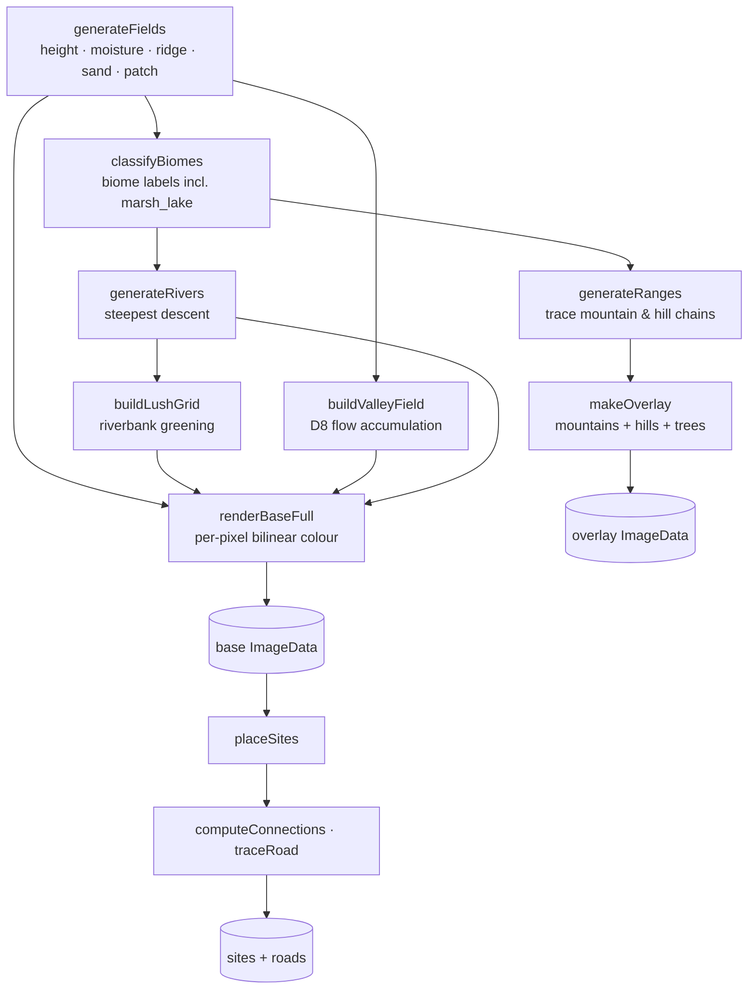

# Map Generator — `systems/map_generator.lua`

*Created: 2026-08-02*
*Status: Current*

Reference for how the procedural painted world map is generated. This module
produces **one continuous painted map** (no tiles, no grid) for the Realm of
Geherra world, plus the settlement sites and roads that sit on top of it.

---

## 1. What it produces

| Output | Description |
| --- | --- |
| `base` (ImageData) | Full-resolution painted terrain (biomes, coasts, rivers baked in via colour). |
| `overlay` (ImageData) | Transparent layer of drawn **trees, mountain peaks and hill mounds**. |
| `rivers` | Polylines (sample coords) of river courses. |
| `biome` grid | Per-sample-cell biome label (`ocean`, `plains`, `forest`, `marsh_lake`, …). |
| `height` / `moisture` / `ridge` / `sand` / `patch` / `valley` grids | Raw scalar fields used to drive everything else. |
| `sites` + `roads` | Settlement positions (pixel coords + biome) and connecting road polylines. |

Optionally it can export these to disk (see §2) — used by the standalone tool
and by future asset pipelines — or it can feed them **in-memory** directly to
the game's world loader (`systems/painted_map_loader.lua`).

---

## 2. Two ways to use it

### 2.1 Standalone export tool (file-based)

Wire an entry point in `main.lua`, then run from the repo root:

```text
love . --generate-map world --seed 1336 --size 4096 --detail 4
love . --generate-map sites --seed 1336 --sites 14
```

Writes into `src/assets/map/generated/<seed>/`:

| File | Contents |
| --- | --- |
| `meta.lua` | `{ seed, sizeW, sizeH, sampleW, sampleH }` |
| `height.png` / `moisture.png` | Grayscale sample-resolution field dumps (needed by the `sites` stage). |
| `world.png` | Rendered painted world (base + overlay + rivers). |
| `map_with_sites.png` | World + roads + site markers. |
| `sites_roads.lua` | `{ seed, size, sites[], roads[] }` so location sprites can be placed later. |

Progress is mirrored to `src/assets/map/generated/run.log` (LÖVE is a GUI app, so
`print` alone is invisible).

### 2.2 In-memory generation (runtime)

```lua
local MapGenerator = require("systems.map_generator")
local world = MapGenerator.generateWorld(seed, sizeW, sizeH, detail)
```

This is what the game actually uses today — the debug world-map view and the
world-generation splash call `MapGenerator.generateWorld` / `createGeneration`
and never touch the filesystem. See §9.

---

## 3. Pipeline overview



Roughly: **fields → biomes → rivers/valleys/ranges → render → sites/roads.**

---

## 4. Configuration (`CONFIG`)

All tunables live in the `CONFIG` table near the top of the file. Highlights:

| Group | Keys | Meaning |
| --- | --- | --- |
| Size | `defaultSeed` (1336), `defaultWidth` (3500), `defaultHeight` (2048), `defaultDetail` (2) | Output is golden-ratio landscape (W:H ≈ 1.618). |
| Sampling | `minSample` (128), `maxSample` (2048) | The field buffer is `clamp(longest/detail, min, max)`; terrain is bilinearly upscaled at render time so big outputs stay fast. |
| Domain warp | `warpFreq` (1.6), `warpStrength` (0.12) | Curls coastlines/rivers/ridges organically. |
| Elevation | `oceanLevel` (0.42), `beachLevel` (0.46), `hillsLevel` (0.72), `mountainLevel` (0.79), `snowLevel` (0.85), `sandThreshold` (0.5) | Terrain bands. |
| Island shape | `islandMix` (0.40), `islandPower` (3.2), `heightExponent` (1.05) | Weak rim pull → land fills the map. |
| Moisture | `moistureDry` (0.18), `moisturePlains` (0.42), `moistureForest` (0.62), `moistureWet` (0.85), `aridSpread`/`aridBand`/`poleDry` | Biomes + dry/wet zones. |
| Marsh lakes | `marshLakeThreshold` (0.62) | Patch-noise peaks in the marsh become `marsh_lake` (impassable). |
| Rivers | `riverCount` (12), `riverSourceLevel` (0.55), `riverWidth` (0.010), `riverGreenRadius` (8), `riverGreenStrength` (0.4) | Steepest-descent rivers + riverbank oases. |
| Ranges | `mountainRanges` (18), `hillRanges` (18), `rangeMinRidge`/`rangeMinHeight`/`rangeMaxSteps`, glyph step config | Traced crest lines → drawn glyphs. |
| Density | `forestDensity` (0.17), `marshDensity` (0.04) | Tree coverage in the overlay. |
| Sites | `siteCount` (14), `siteMinDist` (32), `sitePadding` (5), `roadWidthFrac`, `siteRadiusFrac` | Settlement + road layout. |
| `roadPath` | `blocked` (ocean/marsh_lake/snow), `cost` per biome (plains 1.00 … marsh 2.90), `climbCost` (2.2), `heightCost` (0.40), `valleyBonus` (0.45), `shortcutMaxCost` (1.8), `maxExpansions` (400000) | Terrain-aware A* road pathfinding tuning (see §10.3). |
| `palette` | art-bible colours | Every colour used by `pxColor`, glyphs, rivers, roads, sites. |

---

## 5. Noise & terrain fields

### 5.1 Seeded noise without a seedable RNG

`love.math.noise` is deterministic but **cannot be seeded directly**, so the
generator shifts sample coordinates by per-seed/per-channel offsets:

```lua
local function perlin(x, y, seed, channel)
    local ox = (seed % 104729) * 0.0013 + channel * 17.131
    local oy = (seed % 104729) * 0.0007 + channel * 31.719
    return love.math.noise(x + ox, y + oy)
end
```

### 5.2 Fields

`generateFields(seed, sampleW, sampleH)` produces five grids:

- **height** — 5-octave fBm, island-shaped and exponent-redistributed.
- **moisture** — 4-octave fBm pushed into distinct dry/wet zones (`aridSpread`),
  with broad dry belts (`aridBand`) and drier poles (`poleDry`).
- **ridge** — 4-octave fBm run through a **ridged** transform
  (`1 - |2r - 1|`) to create sharp mountain spines.
- **sand** — 3-octave field deciding sandy beaches vs rocky cliffs.
- **patch** — 2-octave high-frequency field driving marsh-lake pockets and
  forest grove/clearing variation.

Every field is sampled through the **same** domain-warped coordinates, so all
features share one organic curl.

### 5.3 Domain warp

```lua
local function domainWarp(seed, u, v)
    local wx = fbm(seed + 271828, u * warpFreq, v * warpFreq, 0, 3, 2.0, 0.5) - 0.5
    local wy = fbm(seed + 314159, u * warpFreq, v * warpFreq, 1, 3, 2.0, 0.5) - 0.5
    return u + wx * warpStrength, v + wy * warpStrength
end
```

Two low-frequency fractal displacement fields are added to the sample
coordinates before evaluating the real fields — the classic "fractal noise"
upgrade that makes coastlines and ridges wind naturally.

### 5.4 Island shaping

```lua
local d = 1 - (1 - nx * nx) * (1 - ny * ny)
d = d ^ islandPower
e = e * (1 - islandMix) + (1 - d) * islandMix
```

Only the outer rim is pulled toward the sea (weak island mix), so the interior
stays land and the map is mostly navigable terrain.

---

## 6. Biome classification

`classifyBiomes` runs `biomeOf(e, m, r, sand, patch)` per sample cell and
produces the label grid. Order of checks:

1. `e < oceanLevel` → **ocean**
2. `e < beachLevel` → **beach** (if `sand > sandThreshold`) or **cliff**
3. `e > snowLevel` → **snow**
4. `e > mountainLevel` → **mountain** (if `r > 0.45`) or **hills**
5. `e > hillsLevel` → **hills**
6. `m < moistureDry` → **desert**
7. `m < moisturePlains` → **plains**
8. `m < moistureWet` → **forest**
9. otherwise → **marsh**, unless `patch > marshLakeThreshold` → **marsh_lake**

`marsh_lake` is its own biome (dark water pockets). It is treated as
**impassable** by the game's navigation grid and excluded from site/road
placement.

The biome label is used for gameplay data, tree/mountain placement, and the
debug biome HUD — while **colour** is computed separately per output pixel by
`pxColor` (smooth blending, no hard edges).

---

## 7. Rivers & valleys

### 7.1 Rivers (`generateRivers`)

Each river starts at a random high-elevation cell (`>= riverSourceLevel`) and
follows **steepest descent** among its 8 neighbours until it hits the coast or
merges into an existing river. Requires a minimum path length (`>= 4`) to
count.

### 7.2 Riverbank greening (`buildLushGrid`)

A soft weight field around river points makes lowland land greener (oases).
Only land cells (`e >= oceanLevel`) receive it.

### 7.3 Valleys (`buildValleyField`)

D8 **flow accumulation**: every land cell sends 1 unit of water to its
steepest downhill neighbour, then the accumulated flow is log-scaled
(`2^3 … 2^10.5` → `0..1`) and blurred (two 3×3 passes) into a "valley" field.
This drives the dark erosion lines in `pxColor` and helps place hill/mountain
glyphs along drainages.

---

## 8. Mountain & hill ranges

`generateRanges` traces connected crest lines instead of scattering isolated
peaks:

1. Find a strong seed cell (high ridge + correct elevation band).
2. Greedily walk to the best neighbouring ridge cell, biasing toward the
   current heading (`align`) so chains run long and straight-ish.
3. Stop when the chain wanders out of the elevation/ridge band.

Two sets are traced — `mountainChains` (mountains/snow) and `hillChains`
(hills) — each with its own band and glyph spacing.

---

## 9. Rendering

Rendering happens in pure CPU `ImageData`, never per-frame:

- **`renderBaseFull`** — for every output pixel, bilinearly interpolates the
  coarse fields and calls `pxColor` for a smooth colour (crisp coastlines, no
  blocky upscaling). Handles ocean depth shading, desert↔plains↔forest↔marsh
  gradients, marsh lakes, hill shading, plateaus, mountain crests, snow caps,
  river oases, coastal waterlines, and valley erosion shading.
- **`makeOverlay`** — bakes **trees** (into forest/marsh cells, density driven
  by the patch field), **mountain peaks** (shaded triangles + snow caps) and
  **hill mounds** (domes with shaded flanks) into a transparent overlay,
  placed only along the traced chains / grove cells.
- Rivers are drawn as smooth polylines with `riverWidth`.

The final world image = base + overlay + rivers (see `renderWorldAndQuit`).
The sites stage adds roads + site markers (`renderSitesAndQuit`).

---

## 10. Sites & roads

### 10.1 Placement (`placeSites`)

Candidates are land cells outside the edge padding that are **not** `ocean`
or `marsh_lake`. Sites are chosen randomly with a minimum separation
(`siteMinDist`), relaxing the distance as attempts run out (distance
relaxation), with a greedy fallback fill.

`placeSitesForMap` converts each site from sample coords to **pixel coords**
(`px`, `py`) and records its `biomeId`; it then overwrites `x`/`y` with the
pixel coords so downstream consumers (location population) use world space.

### 10.2 Connections (`computeConnections`)

A **minimum spanning tree** (Kruskal over all pairwise distances) connects
every site — the cheapest road network that links the whole map.

### 10.3 Roads (`traceRoad`)

Each MST edge is walked from site A to site B via an **A\* search over the
sample grid** (`CONFIG.roadPath`), not a straight line nudged around water.
The cost of entering a cell is its biome cost (plains cheapest, marsh/desert
expensive, `ocean`/`marsh_lake`/`snow` fully blocked) plus a climb penalty
proportional to the elevation gained and a discount for high valley/flow
cells — so roads hug valleys and gentle ground, avoid marshes/deserts/
mountains, and never cross impassable peaks or water. After the search, a
string-pull pass drops waypoints wherever a straight shortcut stays on cheap
ground (`shortcutMaxCost`), then a 2-pass moving-average smooths the polyline
so it reads as a curved road instead of stair-stepping.

---

## 11. Step-driven async generation (`createGeneration`)

The runtime path breaks the whole pipeline into **10 named stages** so a splash
state can show live progress:

| # | Stage |
| --- | --- |
| 1 | Sampling terrain fields |
| 2 | Classifying biomes |
| 3 | Tracing rivers |
| 4 | Greening riverbanks |
| 5 | Carving valleys & drainages |
| 6 | Raising mountain & hill ranges |
| 7 | Drawing terrain |
| 8 | Painting trees & peaks |
| 9 | Placing sites |
| 10 | Tracing roads |

```lua
local gen = MapGenerator.createGeneration(seed, W, H, detail, siteCount)
-- gen.totalSteps == 10
while not gen:advance() do
    -- one stage per call; gen.progress() ∈ [0,1]; gen.currentName = stage name
end
local result = gen.result   -- { world = {...}, sites = {...}, roads = {...} }
```

`generateWorld` and `generateSites` remain as thin synchronous wrappers for
the debug view and the file-based stages.

---

## 12. Public API

| Export | Purpose |
| --- | --- |
| `defaultSeed`, `defaultWidth`, `defaultHeight`, `defaultDetail`, `defaultSiteCount` | Defaults (mirror `CONFIG`). |
| `generateWorld(seed, W, H, detail)` | Synchronous world generation → `{ base, overlay, rivers, biome, height, moisture, ridge, sand, valley, patch, … }` (no sites). |
| `generateSites(world, siteCount)` | Sites + roads from a generated world → `{ sites, roads }`. |
| `createGeneration(seed, W, H, detail, siteCount)` | Async 10-step generator → stepper object (§11). |
| `traceRoads(sites, world)` | Re-traces a road network connecting only the given sites (each `{ id, px, py }`) over an already-generated `world` — used to rebuild roads once real location types are known (see §13). |
| `prepare(stage)` / `runFrame()` | Standalone export CLI plumbing (`world` / `sites` stages). |

### Site shape

```lua
{ id = "site_1", x = <pixel>, y = <pixel>, px = <pixel>, py = <pixel>, biomeId = "plains" }
```

### Road shape

```lua
{ from = "site_1", to = "site_2", points = { { x = ..., y = ... }, ... } }  -- pixel coords
```

---

## 13. Game integration

- `systems/painted_map_loader.lua` calls `createGeneration`, builds the
  playable `Map` from `result.world` (images + biome grid), and derives a
  navigation grid where `ocean` and `marsh_lake` are impassable.
- `game/states/world_generation_state.lua` (the splash) advances one stage per
  frame, drawing a progress bar + current stage name, then hands off to the
  world state.
- `game/states/world_map_state.lua` (debug) uses `generateWorld` in-memory to
  render a full-screen pan/zoom view.
- Sites become enterable `Location` entities via
  `LocationPopulationSystem.populate(map, map.worldGen)`. Roads are traced
  once for all sites during generation, but `populate` then calls
  `MapGenerator.traceRoads` a second time to rebuild the network connecting
  only "road-worthy" location types (`locationPopulation.roadWorthyTypes`,
  default `village`/`town`/`castle`) — other location types end up with no
  roads at all.

---

## 14. Gotchas & notes

- **`love.math.noise` is not seedable** — reproducibility comes from the
  per-seed coordinate offsets; changing the seed changes the offset, not the
  noise itself.
- **`goto`/labels** are used (LuaJIT 2.1 supports them); keep that in mind if
  porting to stock Lua 5.1.
- **LÖVE GUI output is invisible on the console** — use the `run.log` mirror
  (or a file the script writes itself) when automating verification.
- The game currently runs the map **fully in-memory** at 3500×2048 (~2.5s);
  the file export path exists but is not wired into `main.lua`.
